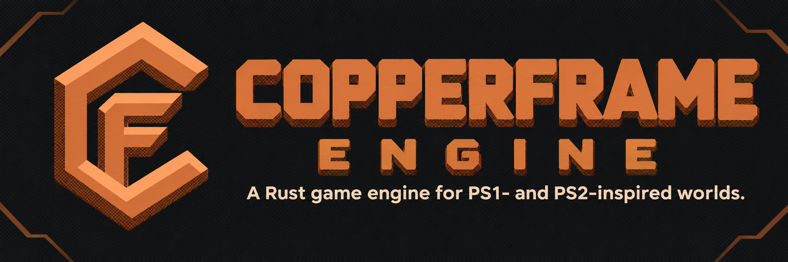

<p align="center">
  
</p>

# Copperframe Engine

A Rust game engine for making original 3D games with PlayStation 1 and
PlayStation 2-inspired visuals on modern PCs. It is not an emulator or a
console SDK. (Formerly "PSX Engine"; see
[docs/MIGRATION.md](docs/MIGRATION.md#rename-to-copperframe) for what the
rename changed.)

Built editor downloads will be published on itch.io:
[allyn-david.itch.io/copperframe-engine](https://allyn-david.itch.io/copperframe-engine).

**Documentation:** the [Copperframe wiki](https://jasonalkain.github.io/PSX-Game-Engine/)
covers getting started, the editor, PS1/PS2 style settings, assets,
behaviours, testing, exporting, the CLI and file formats. Its source is in
[docs/wiki/](docs/wiki/src/SUMMARY.md).

**Status: all six milestones implemented (Milestone 6: performance
measurement, hardening, regression images, migration guide). Validated on
Linux with a software GPU; Windows 11 runtime checks are still
outstanding.** Early prototype, not production-ready.

What works: a retro renderer with PS1, PS2 and Clean presets (low internal
resolution with integer or fit upscaling, vertex snapping, affine texture
mapping, colour reduction, ordered dithering, fog; filtered and mipmapped
textures, per-vertex or per-pixel lighting, bounded point lights, blob
shadows); skinned glTF characters with animation clips and crossfades;
versioned JSON scenes edited in an egui editor and
by the `copperframe` command-line tool through one command layer; glTF (static and
skinned) and PNG/JPEG import; and gameplay: Rust behaviours registered by a game crate,
rapier3d physics (static/dynamic/kinematic bodies, sensors, ray casts, a
first-person character controller), kira audio (music/effects buses,
positional sources), named input actions with rebinding, title/pause/
settings menus, play mode in the editor, headless scripted runs, and host
export. The example project is a short exploration game, *The Lever Room*.
See [docs/STATUS.md](docs/STATUS.md) for what has and has not been verified
(Windows 11 runtime checks are still outstanding) and
[docs/ROADMAP.md](docs/ROADMAP.md).

## Requirements

- Rust via [rustup](https://rustup.rs). The toolchain version is pinned in
  `rust-toolchain.toml` and installed automatically on first build.
- A GPU and driver supporting Vulkan, DirectX 12, Metal or OpenGL ES 3
  (through `wgpu`). Only WebGPU default limits are required.
- Windows 11 x86-64 is the primary target. Linux builds and runs (tested on
  X11 with Mesa lavapipe); macOS is untested.
- Linux only: X11/Wayland client libraries, including `libxkbcommon-x11`,
  and ALSA headers (`libasound2-dev`) to build the audio backend.
- A missing audio device is not an error: games run silently and say so.

## Play the demo

```sh
cargo run -p lever_room --release
```

*The Lever Room*: find the lever that opens the door, follow the humming
corridor, and reach the exit. The caretaker by the east wall waves and
talks when you use him. Settings > Graphics style switches between the
scene's own style, PS1 and PS2 while playing. `W` `A` `S` `D` move, the mouse looks,
`Shift` runs, `Space` jumps, `E` (or left click) interacts, `Esc` pauses.
Settings (volumes, mouse sensitivity and inversion, fullscreen, vsync,
graphics style, key rebinding) and the save used by *Continue* are stored in your user folder
(for example `%APPDATA%\Copperframe Engine\the-lever-room` on Windows), never in
the project.

Every game executable also accepts:

| Option | Effect |
| --- | --- |
| `--headless [--ticks N]` | run without a window, GPU or audio; print a JSON report |
| `--script FILE` | headless run driven by an input script with expectations (exit code 1 if one fails) |
| `--schema` | print the behaviour kinds the game registers (JSON) |
| `--project DIR`, `--scene FILE` | choose what to play |
| `--play` | editor play mode: no title screen, never writes saves |
| `--user-dir DIR` | keep settings and saves in DIR |
| `--frames N` | exit after N frames (smoke tests) |
| `--bench [--frames N] [--bench-size WxH]` | measure tick and frame times offscreen in the authored, PS1 and PS2 styles (JSON report; uses `--script` as input if given) |

```sh
cargo run -p lever_room -- --script examples/room/scripts/walkthrough.script.json
```

## Editor and command-line tool

Open the example project in the editor:

```sh
cargo run -p copperframe_editor --release -- examples/room
```

Or create a new project and open it:

```sh
cargo run -p copperframe_cli --release -- new my_game --name "My game"
cargo run -p copperframe_editor --release -- my_game
```

A project is a folder with `project.json`, `assets/` (source files plus
`.meta.json` sidecars that hold each asset's stable ID), `scenes/`, an
optional `input.json` (default key bindings) and `game/`, a Rust crate with
the game's behaviours. `copperframe new` writes that crate with a path dependency on
this engine checkout (so keep the checkout where it is) and a starter scene
you can play at once; `--no-game` skips it and the project then plays in the
stock `copperframe_player` with engine behaviours only. Copy `.gltf`/`.glb` models,
`.png`/`.jpg` textures and `.wav`/`.ogg` sounds into `assets/`; the editor's
Assets tab (or `copperframe import`) registers them.

**Play** (or `F5`) builds and runs the game in its own window on a copy of
the current scene, unsaved edits included; the authored scene file is never
written by play mode. The game's log streams into the console; **Stop** (or
`F5`) ends it. **Game > Export** saves, builds a release package into the
folder shown (default `dist/<name>` in the project) and checks that it
starts.

Editor controls:

| Input | Action |
| --- | --- |
| Left click in the viewport | select (click empty space to clear) |
| Drag a gizmo arrow | move the selection along X (red), Y (green) or Z (blue); with Edit > Snap on, moves in steps (0.25 m by default) |
| Right mouse drag | look; with `W` `A` `S` `D` `E` `Q` to fly, `Shift` faster |
| Mouse wheel | dolly |
| `Ctrl+S` | save |
| `Ctrl+Z` / `Ctrl+Shift+Z` or `Ctrl+Y` | undo / redo |
| `Ctrl+D` / `Delete` | duplicate / delete the selection (with children) |

The hierarchy panel selects; the inspector's parent box reparents (keeping
the world position). The inspector edits name, transform
(position, Euler rotation in degrees, scale), mesh and material overrides,
collider (shape, body type, sensor, layer, mass, friction; drawn as
wireframes, toggle in Edit > Show colliders), audio source and behaviours
(fields come from the game's schema; "Reload" rebuilds and re-reads it);
Scene settings edit the style preset, lighting and camera start. The editor
holds `.psx/editor.lock` while open, warns before closing with unsaved
changes, and refuses to overwrite a scene that changed on disk unless you
choose to.

`copperframe` commands (add `--json` for machine-readable output; exit codes 0 ok,
1 validation or batch failure, 2 usage, 3 conflict or editor lock, 4 I/O):

```sh
copperframe new DIR [--name NAME]
copperframe validate [--project DIR]                 # project, metadata, imports, scenes
copperframe import [--project DIR] [FILE]            # register + test-import assets
copperframe inspect [--project DIR] [SCENE]          # entities with IDs and components
copperframe apply [--project DIR] [--scene SCENE] [--dry-run] BATCH  # all-or-nothing; BATCH may be -
copperframe schema [--project DIR]                   # formats, components, commands (+ the game's behaviours)
copperframe test-scene [--project DIR] [SCENE] [--script FILE | --ticks N]  # headless play, JSON report
copperframe build --out DIR [--project DIR] [--replace] [--script FILE] [--no-verify]  # export
copperframe bench [--project DIR] [SCENE] [--script FILE] [--frames N] [--size WxH]  # release build, frame/tick times
```

`copperframe build` validates the project, builds the game in release mode, and
writes `DIR/` with the executable, `data/` (project file, scenes, assets),
`NOTICES.txt` (third-party crates and licences from the dependency graph),
`README.txt` and `export.json`. It only replaces a folder that holds an
earlier export, and then runs the export headless from a temporary folder
whose name has spaces. The executable finds `data/` next to itself, so the
folder can be moved or zipped.

Use `cargo run -p copperframe_cli --release -- <command>` or the built
`target/release/copperframe`. `examples/room/build_room.batch.json`,
`build_demo.batch.json`, `fixed_camera.batch.json` and
`visuals.batch.json` (caretaker, lights, shadows) are the batches that built
the example scene, in that order. The example's art (including the skinned
caretaker) is generated by `cargo run -p copperframe_assets --example
make_room_assets`. Command batches and file formats are
documented in [docs/ARCHITECTURE.md](docs/ARCHITECTURE.md).

## Sandbox

The renderer comparison scene from Milestone 2:

```sh
cargo run -p copperframe_sandbox --release
```

Camera: click in the window to capture the mouse, move the mouse to look,
`W` `A` `S` `D` to move, `E`/`Q` up/down, `Shift` to move faster, `Esc` to
release the mouse. Close the window to quit.

Style (the window title shows the current state):

| Key | Action |
| --- | --- |
| `1` | low-resolution rendering on/off |
| `2` | vertex snapping on/off |
| `3` | affine texture mapping on/off |
| `4` | colour reduction on/off |
| `5` | dithering on/off |
| `6` | fog on/off |
| `7` | integer scaling / aspect fit |
| `[` `]` | colour bits per channel −/+ |
| `-` `=` | snap grid finer/coarser |
| `P` | next preset (PS1, PS2, Clean) |
| `C` | split view: current style on the left, effects off on the right |
| `F5` / `F9` | save / reload style settings |
| `F1` | print the key list to the log |

Options: `--style PATH` chooses the style settings file (default
`psx_style.json` in the current directory; loaded at start if it exists),
`--split` starts in split view, and `--frames N` exits after presenting N
frames (for smoke tests).
Set `RUST_LOG=debug` for more logging, and `WGPU_BACKEND=vulkan|dx12|metal|gl`
to force a graphics backend.

## Tests

```sh
cargo test --workspace
```

The offscreen image tests (one per effect), the comparison-scene camera
sweep and the scene-resource test need a graphics adapter and print `SKIPPED` without one. Set
`COPPERFRAME_REQUIRE_GPU=1` to make a missing adapter a failure. Debug images land
in `target/tmp/`. Reference images of the example room live in
`crates/copperframe_runtime/tests/golden/` and are compared only on Mesa llvmpipe
(the CI adapter); after an intended visual change, regenerate them with
`COPPERFRAME_UPDATE_GOLDEN=1 cargo test -p copperframe_runtime --test scene_resources` and
review the PNGs. File format history and API changes per milestone are in
[docs/MIGRATION.md](docs/MIGRATION.md); platform checklists in
[docs/PLATFORMS.md](docs/PLATFORMS.md). Gameplay tests (physics, audio state, the simulation and
the demo walkthrough in `examples/room/game/tests`) run headless and need
neither a GPU nor an audio device.

## Releases

Pushing a `v*` tag builds the Windows editor and publishes it to
[itch.io](https://allyn-david.itch.io/copperframe-engine); setup and steps
are in [docs/RELEASING.md](docs/RELEASING.md).

## Layout

| Path | Purpose |
| --- | --- |
| `crates/copperframe_core` | Fixed-step timing, stable IDs, atomic file writes, retro style settings and their JSON file format. No GPU/window deps. |
| `crates/copperframe_scene` | Scene document (entities, hierarchy, transforms, mesh/material, collider, audio, behaviour, light, animator and shadow components), versioned scene file, commands, undo/redo history, command batches. No GPU/window deps. |
| `crates/copperframe_assets` | Projects, asset metadata and database, glTF (static and skinned) and texture import, animation data, validation, export. No GPU/window deps. |
| `crates/copperframe_render` | wgpu device, surface presenter, retro renderer (scene + composite passes), materials, fit policy, camera, mesh/texture data, WGSL shaders. |
| `crates/copperframe_runtime` | winit event loop, input sampling, fly camera, comparison scene, style keys, frame loop, logging, GPU scene resources and picking. |
| `crates/copperframe_game` | Gameplay runtime: behaviour registry and game API, hecs runtime world, physics (rapier3d), audio (kira), input actions, headless runner, animation playback, benchmark, the game window with menus, and the command line every game binary shares. |
| `crates/copperframe_editor` | egui scene editor (library + `copperframe_editor` binary). |
| `apps/copperframe_cli` | `copperframe` command-line tool. |
| `apps/copperframe_player` | Stock player for projects without a game crate. |
| `apps/copperframe_sandbox` | Sandbox application showing the comparison scene. |
| `examples/room` | Example project *The Lever Room*: scenes, models, texture, generated sounds (`tools/make_sounds.py`), scripts, and its game crate `game/` (`lever_room`). |

## License

MIT, see [LICENSE](LICENSE).
