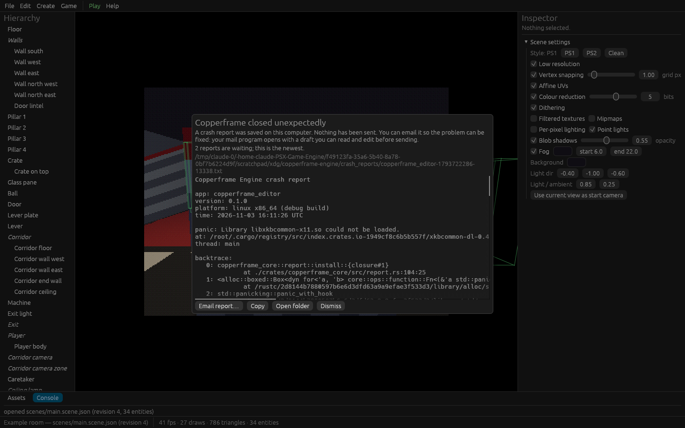

# The editor

```sh
cargo run -p copperframe_editor --release -- PROJECT_DIR [--scene PATH] [--steal-lock] [--frames N]
```

`PROJECT_DIR` defaults to the current folder. `--scene` opens a scene other
than the project's startup scene. `--steal-lock` takes over a project whose
lock is held by a hung editor (see [Project lock](#project-lock)).
`--frames N` exits after N frames, for smoke tests.



## Layout

| Area | What it does |
| --- | --- |
| Menu bar | **File**, **Edit**, **Create**, **Game**, a **Play**/**Stop** button that is always visible, and **Help** |
| Hierarchy (left) | Every entity in the scene, children indented under parents. Click to select |
| Viewport (centre) | The scene rendered with its own retro style, with the selection gizmo and optional collider wireframes |
| Inspector (right) | The selected entity's components, or **Scene settings** when nothing is selected |
| Assets / Console (bottom) | The project's asset list, and the log (including a running game's output) |
| Status bar | Project and scene name, revision, unsaved state, frame rate, draw and triangle counts, and "idle" when the editor is not redrawing |

## Viewport controls

| Input | Action |
| --- | --- |
| Left click | Select the entity under the cursor; click empty space to clear |
| Drag a gizmo arrow | Move the selection along X (red), Y (green) or Z (blue). With **Edit > Snap** on, moves in steps (0.25 m by default) |
| Hold right mouse button | Look around; `W` `A` `S` `D` `E` `Q` fly while held, `Shift` is faster |
| Mouse wheel | Move forward or back |

The gizmo only translates. Rotation and scale are edited as numbers in the
inspector.

## Keyboard shortcuts

| Keys | Action |
| --- | --- |
| `Ctrl+S` | Save |
| `Ctrl+Z` | Undo |
| `Ctrl+Y` or `Ctrl+Shift+Z` | Redo |
| `Ctrl+D` | Duplicate the selection (with its children) |
| `Delete` | Delete the selection (with its children) |
| `F5` | Play / Stop |

## Menus

- **File**: Save; Reload from disk (discard changes); Quit.
- **Edit**: Undo and Redo (the menu names the step), Duplicate, Delete,
  **Show colliders** (wireframes) and **Snap** (gizmo steps).
- **Create**: Empty, Cube, Plane, Sphere, Quad. New entities appear a few
  metres in front of the editor camera and are selected.
- **Game**: Play/Stop, **Reload behaviour kinds** (rebuilds the game and
  re-reads the behaviours it registers), the **Export folder** and
  **Export** (or **Save and export** when there are unsaved changes).
- **Help**: a summary of the controls and **Report a bug…** (see
  [Crash reports and logs](../help/crash-reports.md)).

## The inspector

With an entity selected, the inspector shows, top to bottom:

- **Name** and **Parent**. Changing the parent keeps the entity where it
  is in the world unless you untick *keep world position*.
- **Transform**: position (metres), rotation (Euler degrees, applied as
  yaw Y, then pitch X, then roll Z) and scale.
- **Mesh**: a primitive shape with an optional texture, or an imported
  model. **Material overrides** replace the model's own values:
  *Tint*, *Alpha* (opaque, cutout with a threshold, or blend), and *Lit*,
  *Flat shading*, *Affine UVs* and *Double-sided*, each of which can be
  *source* (keep the model's value), *on* or *off*.
- **Collider**: shape (box, sphere, capsule, or mesh for static bodies),
  body (static, kinematic, dynamic), sensor, offset, layer, mass and
  friction.
- **Audio source**: sound, bus (effects or music), loop, autoplay, 3D,
  volume in dB and the min/max distance.
- **Behaviours**: the list of gameplay behaviours with their fields. The
  fields come from the game's own schema; **Reload** rebuilds the game and
  reads it again.
- **Point light**, **Blob shadow** and **Animator** (clip, speed, loop,
  autoplay; needs a skinned model). The viewport previews autoplaying clips.

Each section has a **+** button to add it and a **Remove** button. Hints
appear when something will not show, for example a light in a scene whose
style has local lights turned off.

See [Scenes, entities and components](scenes.md) for what every field means.

### Scene settings

With nothing selected the inspector shows **Scene settings**:

- the style: **PS1**, **PS2** and **Clean** preset buttons (the label shows
  *Custom* once you change something), then every effect as a switch with
  its value. See [PS1 and PS2 style settings](style.md);
- the directional light's direction, colour and the ambient level;
- **Use current view as start camera**, which stores the editor view as
  the scene's start camera: where the editor view opens next time, and the
  game's camera until a player or camera zone takes over.

## Assets tab

Lists every file in `assets/` with its kind (model, texture, sound) and
import status (*ok*, a warning count, *failed* or *missing*).

- **Rescan assets folder** registers new files (writes their
  `.meta.json`) and refreshes the list.
- **Add to scene** (models) creates an entity using the model.
- **Reimport** (models and textures) reads the file again after you changed
  it. If the new import fails, the last good version stays on screen and
  the error appears in the console.

There is no file watching yet: after editing a source file, use Reimport.

## Saving, undo and conflicts

Every edit goes through the same command layer the CLI uses and becomes an
undo step. A continuous drag (gizmo or slider) is one step. Undoing back to
the state you saved clears the unsaved marker.

Saves are atomic: the editor writes a temporary file, keeps the previous
version as `<scene>.bak`, then replaces the scene. Each save increments the
scene's **revision**. If the file on disk has a different revision than the
one the editor loaded (for example `copperframe apply` changed it), Save
stops and offers to overwrite with your version or reload from disk.

Closing with unsaved changes asks *Save and quit*, *Quit without saving* or
*Cancel*.

## Play mode

**Play** (or `F5`) writes the current scene, unsaved edits included, to
`.psx/play/` in the project and runs the game on that copy in its own
window, skipping the title screen. The game's log streams into the
Console. **Stop** ends it. Play mode never writes the authored scene, the
undo history, or the game's saves.

If the project has a `game/` crate, Play runs it with `cargo run` (so the
first Play compiles it). Without one, the stock `copperframe_player` is
used.

If the game crashes, the editor shows its crash report. See
[Crash reports and logs](../help/crash-reports.md).

## Project lock

While open, the editor holds `.psx/editor.lock` in the project with an OS
file lock. A second editor, or `copperframe apply`, refuses to edit the
project while it is held. The OS releases the lock when the editor exits or
crashes, so a lock file left behind by a crash is detected and replaced
automatically. `--steal-lock` is only for an editor that is still running
but hung.

## Performance

The editor redraws only when something changes: input, a moving camera or
gizmo, the splash, an animation preview (30 Hz, 10 Hz in the background) or
a running game's output. The status bar says "idle" when it is not redrawing
continuously.
