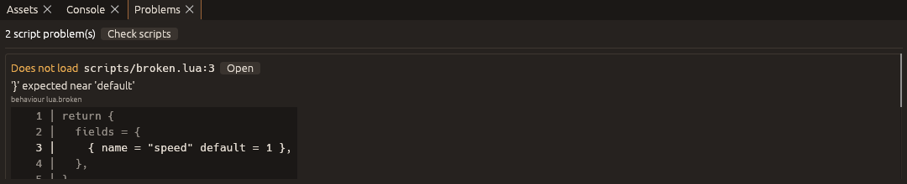

# Lua scripting

Behaviours can be written in Lua 5.4 as well as Rust. A Lua script is a
file in the project's `scripts/` folder; the game loads it at start and it
becomes a behaviour kind like any other. Scenes attach it to entities, the
inspector shows its fields, saves and headless tests treat it the same way.
Nothing has to be installed: Lua is built into every Copperframe game,
including the stock player, so a project without a Rust `game/` crate can
have gameplay code too.

Rust and Lua mix freely: a scene can use `psx.player`, your Rust kinds and
Lua kinds side by side.

## Turning it on or off

Lua is on for every project unless `project.json` says otherwise:

```json
"scripting": { "lua": true }
```

(`project.json` version 5. Older projects load with Lua on, which changes
nothing until you add a `.lua` file.)

## Writing a script

`scripts/spinner.lua`:

```lua
return {
  description = "Turns the entity about its Y axis",
  fields = {
    { name = "speed", default = 90, help = "degrees per second" },
    { name = "running", default = true },
  },
  fixed_update = function(self, ctx)
    if self.running then
      ctx:rotate(self.entity, self.speed * ctx:dt())
    end
  end,
}
```

Its kind is `lua.spinner`. A script in a sub-folder, `scripts/puzzles/door.lua`,
is `lua.puzzles.door`, and the editor files it under **Behaviours > Scripts > puzzles**
in the Add component menu. Behaviour kinds may only use `a-z`, `0-9` and `_`,
so name scripts and folders that way; a script with another name (capitals,
spaces, dashes) is reported and not loaded.

The editor notices new and saved scripts by itself and updates the
inspector and Add component (see [In the editor](#in-the-editor)). Play
always loads the scripts as they are on disk.

### Fields

`fields` is a list. Each entry has a `name` (a Lua identifier other than
`entity` and `prompt`), an optional `help` text, and either a `default`
(its type sets the field's type) or a `kind`:

| Entry | Field |
| --- | --- |
| `{ name = "speed", default = 2.5 }` | number |
| `{ name = "locked", default = false }` | true/false |
| `{ name = "label", default = "Open" }` | text |
| `{ name = "target", kind = "entity" }` | an entity of the same scene (its ID as a string; `ctx:find(self.target)` gives the entity) |

The values set in the scene are in `self` (`self.speed`), with the default
for any the scene does not set.

### Callbacks

All are optional. `self` is a table of its own for each entity: the field
values, `self.entity` (this entity), and anything the script stores there.
It falls back to the script's table, so functions defined there can be
called as `self:open(ctx)`.

| Callback | When |
| --- | --- |
| `start(self, ctx)` | Once, on the first tick after the entity appears |
| `fixed_update(self, ctx)` | Every fixed tick (60 per second) |
| `on_trigger(self, ctx, other, entered)` | A sensor collider on this entity started (`entered` true) or stopped overlapping `other` |
| `on_collision(self, ctx, other, started)` | A solid collider on this entity started or stopped touching `other` (contacts with a dynamic rigidbody) |
| `on_interact(self, ctx, by)` | The player used the interact action while aiming at this entity |
| `on_message(self, ctx, message, from)` | Another behaviour sent this entity a message; `from` may be `nil` |
| `on_destroy(self, ctx)` | The entity is despawned or its scene unloaded |

**Interaction:** set `self.prompt = "Open door"` to make the entity
interactive (the text is shown while the player aims at it); set it to
`nil` to stop.

A complete pair, a lever that opens a door:

```lua
-- scripts/lever.lua
return {
  fields = { { name = "door", kind = "entity", help = "door to open" } },
  start = function(self, ctx) self.prompt = "Pull lever" end,
  on_interact = function(self, ctx, by)
    ctx:send(ctx:find(self.door), "open")
    self.prompt = nil
  end,
}
```

```lua
-- scripts/door.lua
local Door = {}

function Door:open(ctx)
  local x, y, z = ctx:position(self.entity)
  ctx:set_position(self.entity, x, y + 3, z)
  ctx:play_sound(self.entity)
  ctx:event("door_opened")
end

function Door.on_message(self, ctx, message, from)
  if message == "open" then self:open(ctx) end
end

return Door
```

## The `ctx` API

`ctx` is valid only during the callback it is passed to. Entities are
integers, positions and vectors are three numbers, angles are degrees in
yaw, pitch, roll order. Methods that take an entity raise an error for one
that does not exist (check with `ctx:exists(e)` first if it may be gone).

| Method | Does |
| --- | --- |
| `ctx:dt()` | Seconds per tick (1/60) |
| `ctx:tick()` | Ticks since the game started |
| `ctx:me()` | This entity (same as `self.entity`) |
| `ctx:find(id)` | The entity with this ID (a string, as in entity fields), or `nil` |
| `ctx:find_by_name(name)` | The first entity with this name, or `nil` |
| `ctx:id_of(e)` | The entity's ID string |
| `ctx:name(e)` | The entity's name |
| `ctx:exists(e)` | Whether the entity is still there |
| `ctx:parent(e)` | Its parent entity, or `nil` |
| `ctx:position(e)` | `x, y, z`, relative to the parent |
| `ctx:set_position(e, x, y, z)` | Moves it (a kinematic body moves there on the next physics step; a dynamic one is teleported) |
| `ctx:translate(e, dx, dy, dz)` | Moves it by an offset |
| `ctx:world_position(e)` | `x, y, z` in the world, as of the last transform update |
| `ctx:rotation(e)` | `yaw, pitch, roll` in degrees |
| `ctx:set_rotation(e, yaw, pitch, roll)` | Sets the rotation |
| `ctx:rotate(e, yaw, pitch, roll)` | Turns it by these angles, about its own axes (`pitch` and `roll` may be left out) |
| `ctx:scale(e)` | `x, y, z` scale |
| `ctx:set_scale(e, x, y, z)` | Sets the scale |
| `ctx:set_hidden(e, hidden)` | Hides or shows its mesh |
| `ctx:velocity(e)` | Rigidbody velocity, m/s (zeros without one) |
| `ctx:set_velocity(e, x, y, z)` | Sets a dynamic body's velocity |
| `ctx:apply_impulse(e, x, y, z)` | An instant push (N·s) |
| `ctx:add_force(e, x, y, z)` | A force (N) for this tick |
| `ctx:raycast(ox, oy, oz, dx, dy, dz, max, ignore)` | The first solid collider along a ray: `entity, distance`, or `nil`. `ignore` (optional) is an entity to skip |
| `ctx:play_sound(e)` | Starts the entity's audio source |
| `ctx:stop_sound(e, fade)` | Stops it, fading over `fade` seconds (default 0) |
| `ctx:is_sound_playing(e)` | Whether it plays |
| `ctx:play_animation(e, clip, fade, looping)` | Plays a clip on its animator, crossfading over `fade` s (default 0.2), looping by default; `false` if there is no such clip |
| `ctx:stop_animation(e, fade)` | Fades back to the rest pose |
| `ctx:is_animation_playing(e)` | Whether a clip is running |
| `ctx:held(action)` | Whether an input action (`"jump"`, `"interact"`, your own) is held this tick |
| `ctx:pressed(action)` | Whether it was pressed this tick |
| `ctx:axis(negative, positive)` | -1, 0 or 1 from two actions (`ctx:axis("move_left", "move_right")`) |
| `ctx:send(e, message)` | Delivers a text message to the entity's behaviours (Rust or Lua) after this phase; they see this entity as `from` |
| `ctx:show_message(text, seconds)` | Shows text on screen (default 3 s) |
| `ctx:event(name, detail)` | Logs a game event, which headless test scripts can expect (`{"event": "custom", "name": name}`) |
| `ctx:get_state(key)` | A value from the game state (what saves contain), or `nil` |
| `ctx:set_state(key, value)` | Stores a boolean, number or string; `nil` removes it |
| `ctx:despawn(e)` | Removes the entity after this phase |
| `ctx:load_scene(path)` | Loads another scene (project-relative) at the end of the tick; game state is kept |
| `ctx:finish(message)` | Ends the game successfully |
| `ctx:log(text)` | Writes a line to the log (and the editor's console during Play) |

`print(...)` also writes to the log.

## In the editor

- **New Lua script…** (in **Game**, in **Add component > Behaviours >
  Scripts**, and on the Scripting page of Project settings) asks for a
  name, such as `door` or `puzzles/door`, writes a starting script to
  `scripts/`, adds it to the selected entity and opens it in the program
  your system uses for `.lua` files.
- A behaviour card of a Lua kind shows its file and **Edit script**.
- The editor watches `scripts/`: when you save a script in your text
  editor, the inspector shows its new fields within a couple of seconds.
- **Project settings > Scripting** turns Lua on or off for the project and
  lists every script with its behaviour kind.
- The **Problems** panel lists scripts that do not load and errors from the
  last Play, each with the file, line, entity and callback, the lines around
  the error, and **Open**. It opens by itself when a new problem appears;
  the status bar shows how many there are. **Check scripts** loads every
  script again.



## Errors

A script error never stops the game. When a callback raises an error (a
typo, `nil` where a value was expected, a wrong argument to a `ctx` method)
or runs for more than 10 million instructions (an endless loop), that
behaviour is switched off for the rest of the run and the problem is
reported once with the file, line, entity and callback:

```text
scripts/door.lua:7: attempt to perform arithmetic on a nil value (local 'y') (in on_message on "Door"; behaviour lua.door switched off)
```

The report goes to the log (the editor's console and Problems panel during
Play) and to the corner of the game window. A script that does not load (a syntax error, no
`return { ... }`, a bad field) is reported when the game starts and its kind
is not registered, so a scene that uses it does not play and says which
kind is missing.

[Headless runs](testing.md) list script problems under `diagnostics` in
their report and fail, so `copperframe test-scene` and **Build > Run Test
Script** catch script errors.

## What scripts cannot do

Scripts run in a sandbox: only Lua's `table`, `string`, `math`, `utf8` and
`coroutine` libraries are there. There is no `io`, `os`, `require`,
`dofile` or `loadfile`, so a script cannot read or write files or start
programs on the player's computer.
`math.random` starts from the same seed every run, so a headless test and
a played game with the same input behave the same. A script that needs
another script's helpers can put them on an entity and use messages, or
keep the code in one file.
