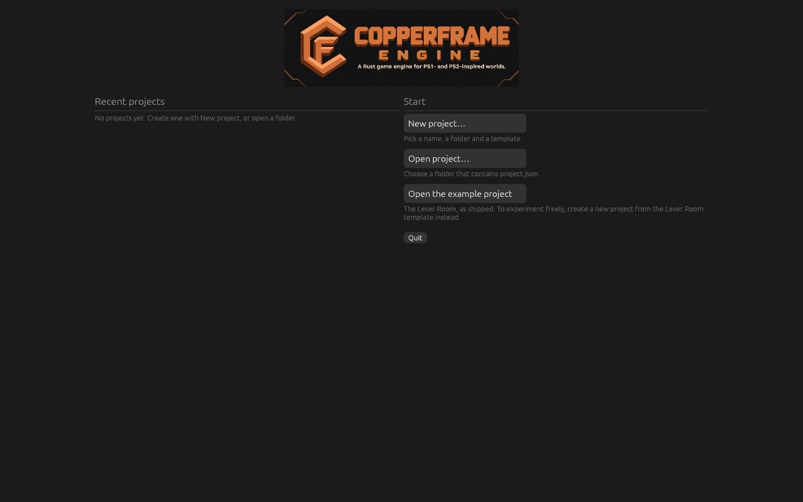

# Projects and the project hub

When you start the editor without naming a project, it opens the **project
hub**. Creating or opening a project happens there, so you never need a
command line to start working.

How to start the editor:

| You have | Start it by |
| --- | --- |
| The Windows download from itch.io | Double-click `copperframe_editor.exe` (or **Launch** in the itch.io app) |
| The engine source | Run `cargo editor` in the engine folder (an alias for `cargo run -p copperframe_editor --release --`) |

The first `cargo editor` compiles the editor, which takes a few minutes.
Later starts take seconds.

## The hub



The left column lists **Recent projects**, newest first, with when you last
opened each one:

- **Open** loads the project in the same window.
- **Show in folder** opens the project folder in Explorer (or your file
  manager).
- **Remove from list** forgets the project in the hub. Its files are kept.

A project whose folder was moved or deleted says *Folder not found*. Use
**Open project…** to find it again.

The right column has:

- **New project…**, which opens the new project form (below).
- **Open project…**, which shows a folder picker. Pick the folder that
  contains `project.json`.
- **Open the example project**, when the example (*The Lever Room*) is
  next to the editor or in the engine source. This opens the example
  itself. To change it freely, create a project from the Lever Room
  template instead.

The list is stored in `recent_projects.json` in the engine's data folder
(`%APPDATA%\Copperframe Engine\copperframe-engine\data` on Windows), next to
crash reports and logs.

## Creating a project

**New project…** asks for:

| Field | What it does |
| --- | --- |
| **Name** | The game's name. The project folder gets the same name, with characters Windows does not allow in file names replaced by `_` |
| **Location** | The folder the project folder is created in. **Browse…** picks one. The default is `Documents\Copperframe Projects`, then wherever you last created a project |
| **Template** | What the project starts with (below) |
| **Include Rust game code** | Adds a `game/` folder with a Rust crate for your own behaviours. See [Behaviours and game code](behaviours.md) |

The form shows the full path it will create. **Create** (or `Enter`) makes
the project and opens it in the editor straight away. The folder must not
exist yet, or must be empty.

### Templates

| Template | Starts with |
| --- | --- |
| **Empty** | One scene with no entities |
| **Starter scene** | A floor, a spinning cube and a first-person player. Press **Play** and walk around immediately |
| **The Lever Room demo** | A copy of the example game: its models, textures, sounds, scene, test script and Rust gameplay code |

### Choosing a gameplay language

Rust is optional. You can attach built-in behaviours immediately or add
Lua 5.4 scripts in `scripts/` without a `game/` crate. To use C# gameplay
scripts, enable C# in **Project settings > Scripting** and install the
.NET 10 SDK; players of exported C# games need the .NET 10 runtime.
You may mix Rust, Lua and C# behaviours within the same scene. See
[Lua scripting](lua.md) and [C# scripting](csharp.md).

### Rust game code

With **Include Rust game code** ticked, the project gets a `game/` crate
that depends on your engine checkout by path. Play, tests and export then
compile it, which needs Rust (installed with [rustup](https://rustup.rs)).

- The option is only available when the editor was built from the engine
  source. The itch.io download makes projects that use the built-in
  behaviours (first-person player, camera zones, spin). Those projects
  play, test and export without Rust.
- The Lever Room template always includes its game code (the lever, door
  and caretaker are Rust behaviours), so it needs the engine source too.
- If Rust is not installed, the form says so and links to rustup. When you
  open a project with game code on a computer without Rust, Play and Export
  show the same prompt. **Check again** looks for Rust after you install it.

## Switching projects

The editor's **File** menu has:

- **New Project…**: closes this project and opens the new project form.
- **Open Project…**: a folder picker for another project.
- **Recent Projects**: the hub's list.
- **Close Project**: back to the hub.

Each of these asks first if the open scene has unsaved changes (**Save**,
**Don't save** or **Cancel**).

## Opening a project that is open elsewhere

Each project can be open in one editor at a time (see
[Project lock](editor.md#project-lock)). If it is already open, the hub
says so. **Open anyway** takes over the project; use it only when the other
editor crashed or hung, because two editors on one project overwrite each
other's changes.

## From the command line

The hub does the same as these commands, which stay available for scripts
and automation:

```sh
copperframe new my_game --name "My Game" --template starter   # or empty, lever-room; --no-game
cargo editor my_game                                           # open a project directly, skipping the hub
```

See [Command-line tool](../reference/cli.md#new).
