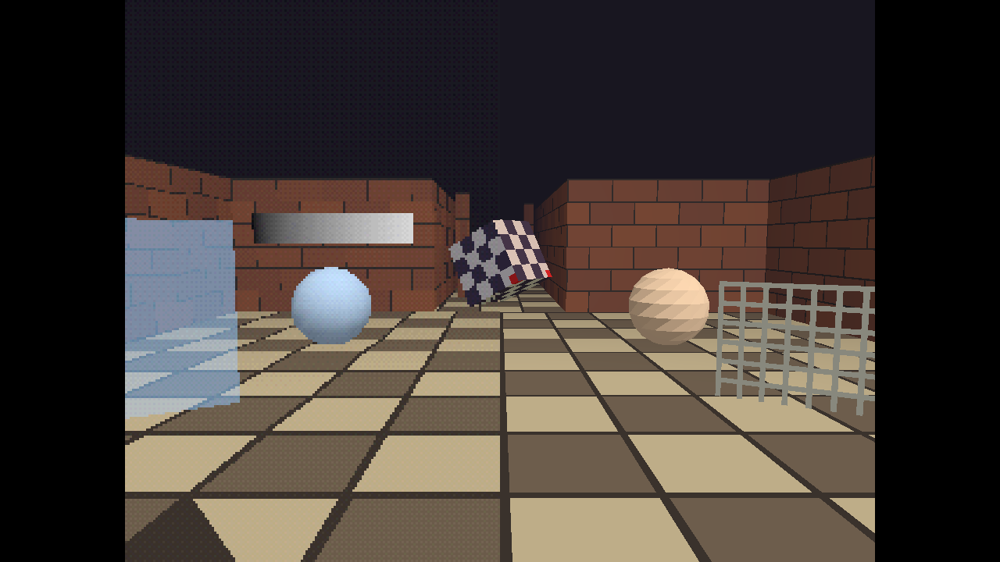
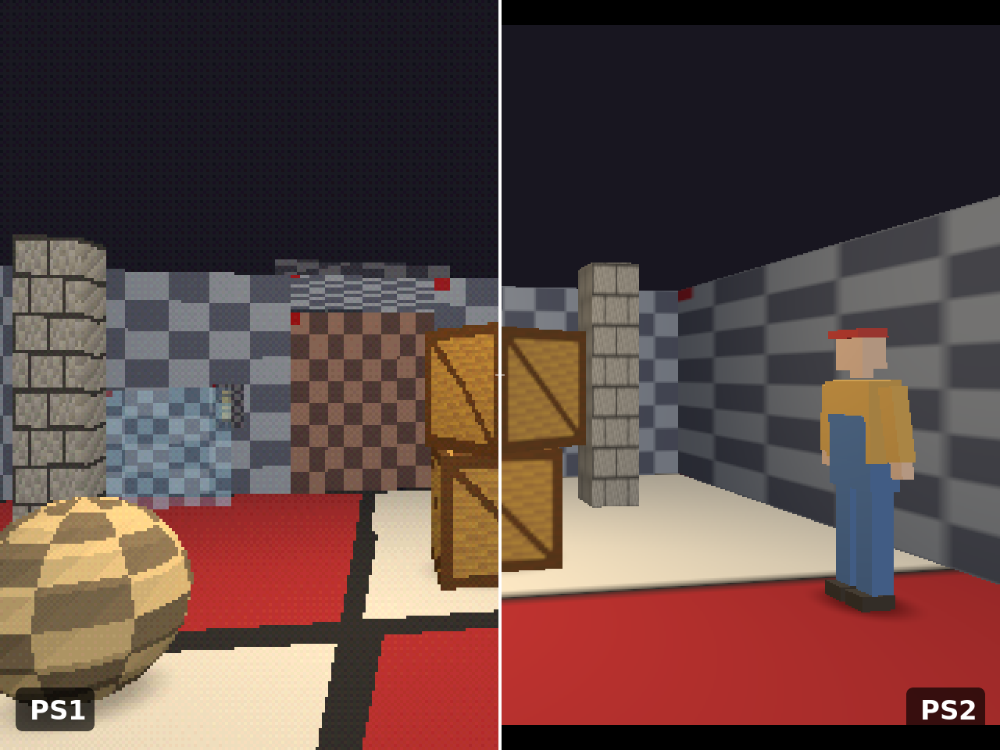
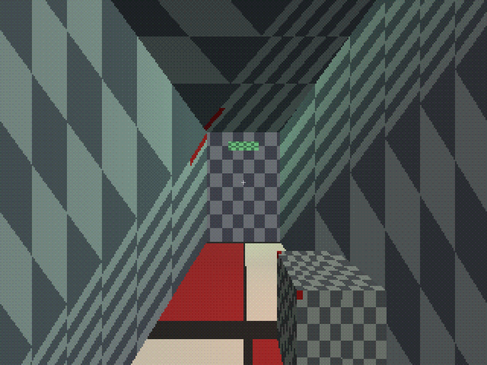
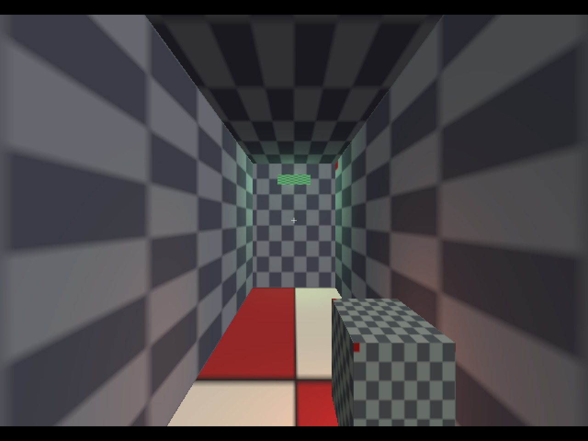

# PS1 and PS2 style settings

Every visual effect that makes a scene look like a PS1 or PS2 game is a
setting in the scene's **style**. Each effect can be switched on and off
independently and tuned. Styles are read every frame, so switching between
PS1 and PS2 never reimports or re-uploads content.

You edit the style in the editor's **Scene settings** (select nothing), in
the sandbox with keys, or in JSON. A player can also override it in the game's
**Settings > Graphics style** (As authored, PS1 or PS2), which applies a
preset's look while keeping the scene's own fog and atmosphere.





## Presets

| Setting | PS1 | PS2 | Clean |
| --- | --- | --- | --- |
| Internal resolution | 320×240 | 640×448 | off (native) |
| Upscaling | integer | fit | fit |
| Vertex snapping | on, grid 1 px | off | off |
| Affine texture mapping | on | off | off |
| Colour reduction | 5 bits per channel | off | off |
| Dithering | on | off | off |
| Texture filtering | nearest, no mipmaps | linear, mipmaps | nearest, no mipmaps |
| Lighting | per vertex | per pixel | per vertex |
| Point lights | on | on | on |
| Blob shadows | on, opacity 0.55 | on, opacity 0.6 | on, opacity 0.55 |
| Fog | on, 6–22 m | same as PS1 | same as PS1 |

**Clean** turns every retro effect off and is mainly a reference image. A
style that matches no preset is reported as **Custom**.

## Settings reference

| Section | Field | Range | Effect |
| --- | --- | --- | --- |
| `low_res` | `enabled`, `width`, `height` | 16–4096 px | Render the world into a small image and upscale it. Off renders at the native size of the on-screen rectangle (same aspect) |
| `presentation` | `scaling` | `integer`, `fit` | `integer`: the largest whole-number scale that fits, centred with black bars (falls back to fit when the window is smaller than the image). `fit`: the largest aspect-correct size; texels may be uneven |
| `vertex_snap` | `enabled`, `grid`, `strength` | grid 0.25–64 px, strength 0–1 | Snap projected vertices to the internal pixel grid: the PS1 "wobble". Larger grids are wobblier; strength 0 equals off. Render-only: physics is unaffected |
| `affine_uv` | `enabled` | | Interpolate texture coordinates linearly in screen space, so textures warp on large polygons. Materials can opt out with `allow_affine: false` |
| `color_reduction` | `enabled`, `bits` | 1–8 | Quantise output to this many bits per channel |
| `dither` | `enabled`, `strength` | 0–1 | 4×4 ordered (Bayer) dither before quantising, anchored to internal pixels. Independent of colour reduction |
| `fog` | `enabled`, `color`, `start`, `end` | metres, `end` > `start` ≥ 0 | Linear distance fog from the camera. Colour is sRGB 0–255 |
| `atmosphere` | `background`, `near`, `far` | near ≥ 0.001, far ≤ 1e6 × near | Clear colour (sRGB 0–255) and camera clip distances |
| `textures` | `filter`, `mipmaps` | `nearest`, `linear` | Crisp texels or bilinear filtering; mipmaps for distant surfaces (trilinear with `linear`) |
| `shading` | `per_pixel`, `local_lights` | | Light every pixel instead of every vertex; apply point lights placed in the scene |
| `shadows` | `enabled`, `opacity` | 0–1 | Blob shadows under entities with a shadow component |

The camera's aspect ratio always follows the internal image, never the
window. For a widescreen look, use a wider internal size such as 426×240
rather than stretching.

| PS1 | PS2 |
| --- | --- |
|  |  |

## Choosing values

- **Authentic PS1:** start from the PS1 preset. 320×240 with integer
  scaling gives crisp, even pixel blocks. Raise `vertex_snap.grid` to 2–4
  for a more unstable look; drop `color_reduction.bits` to 4 for heavier
  banding.
- **Late PS1 / early PS2:** keep 320×240 (or 640×480 for a sharper image), turn off affine
  mapping, keep nearest filtering.
- **PS2:** start from the PS2 preset. Per-pixel lighting makes point lights
  form smooth pools; linear filtering and mipmaps remove shimmer on
  distant floors.
- **Fog** is the cheapest way to sell depth and hide the far plane: set
  `atmosphere.background` and `fog.color` to the same colour and `fog.end`
  a little below `atmosphere.far`.
- Affine warping is strongest on large polygons close to the camera. If a
  floor warps too much, subdivide it or set `allow_affine: false` on that
  material.

## The style file

The sandbox saves and loads its style as `psx_style.json` (F5 / F9):

```json
{
  "format": "psx_style",
  "version": 2,
  "style": {
    "low_res": { "enabled": true, "width": 320, "height": 240 },
    "presentation": { "scaling": "integer" },
    "vertex_snap": { "enabled": true, "grid": 1.0, "strength": 1.0 },
    "affine_uv": { "enabled": true },
    "color_reduction": { "enabled": true, "bits": 5 },
    "dither": { "enabled": true, "strength": 1.0 },
    "fog": { "enabled": true, "color": [24, 22, 32], "start": 6.0, "end": 22.0 },
    "atmosphere": { "background": [24, 22, 32], "near": 0.05, "far": 60.0 },
    "textures": { "filter": "nearest", "mipmaps": false },
    "shading": { "per_pixel": false, "local_lights": true },
    "shadows": { "enabled": true, "opacity": 0.55 }
  }
}
```

The same `style` object is stored inside each scene's settings. Loading
rejects unknown fields and out-of-range values; an invalid file is reported
and left untouched. Version 1 files (before PS2 support) load with the PS1
values for `textures`, `shading` and `shadows`.

## Colour handling

Colours in style settings (fog, background) are the sRGB 0–255 numbers you
read off a colour picker. Material tints, vertex colours and light colours
are linear 0–1. Textures are sRGB. The renderer works in linear light and
applies gamma exactly once.
