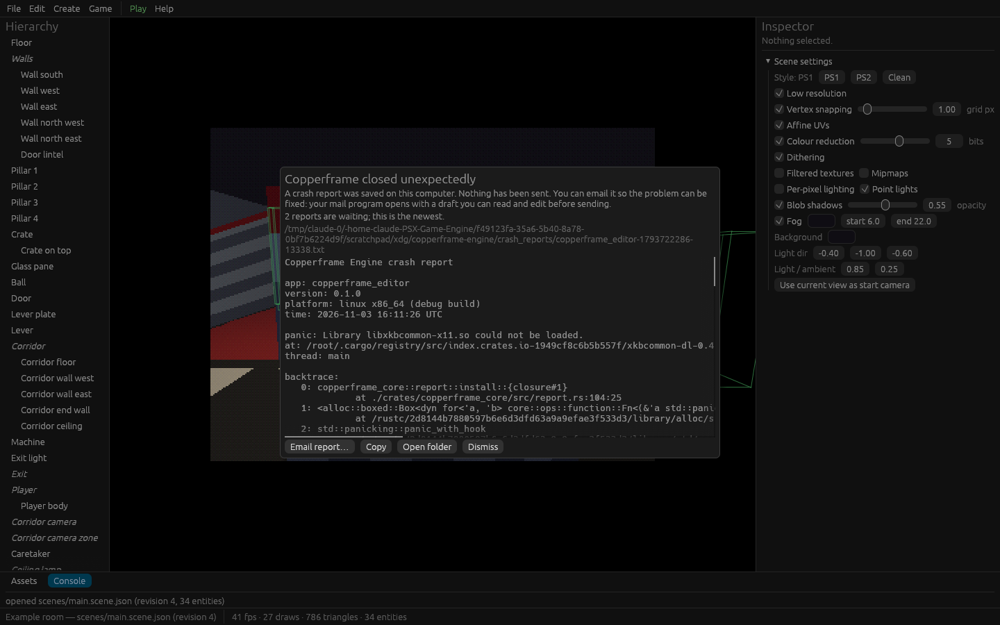

# Crash reports and logs

Every Copperframe program writes a log file, and saves a crash report if it
panics. **Nothing is ever sent automatically.** Reports leave your computer
only if you choose to email them, as a draft you read first in your own
mail program.

## Where they are

| Program | Folder |
| --- | --- |
| Editor, `copperframe` tool, sandbox | Windows: `%APPDATA%\Copperframe Engine\copperframe-engine\data`. Linux: `~/.local/share/copperframe-engine` |
| A game (including the stock player and exported games) | The game's own data folder, next to its saves (for example `%APPDATA%\Copperframe Engine\the-lever-room\data`) |

Inside:

| Path | Contents |
| --- | --- |
| `crash_reports/<app>-<time>-<pid>.txt` | One file per crash: system summary, graphics adapter, the panic message and location, a backtrace, and the last 200 log lines. The newest 20 are kept |
| `logs/<app>.log` | The current run's log (capped at 16 MiB) |
| `logs/<app>.previous.log` | The run before |

When the editor runs your game with **Play**, the game's crash reports go
to the editor's folder instead, so the editor can show them.

## In the editor



When the editor starts, or when a Play session exits with an error, it
shows any crash reports it has not shown before in a **Copperframe closed
unexpectedly** dialog:

- **Email report…** opens a draft addressed to the engine's bug-report
  address in your default mail program, with the report in the body (long
  reports are cut, with a note asking you to attach the full file).
- **Copy** copies the report.
- **Open folder** shows the file.
- **Dismiss** marks it as seen (renamed to `*.seen.txt`) so it is not
  shown again.

**Help > Report a bug…** opens the same kind of draft with system details,
for problems that did not crash. You can also
[open an issue on GitHub](https://github.com/JasonAlkain/PSX-Game-Engine/issues/new?template=bug_report.yml)
and paste the report.

## Games you ship

Games built with Copperframe keep their reports and logs locally and never
offer the engine's address: players of your game should report to you.
Tell your players where the data folder is (it is named after your game's
title) so they can send you `crash_reports/` and `logs/`.

## More logging

Set `RUST_LOG` before starting a program, for example:

```sh
RUST_LOG=debug cargo run -p copperframe_editor --release -- examples/room
```

On Windows PowerShell: `$env:RUST_LOG="debug"`.
