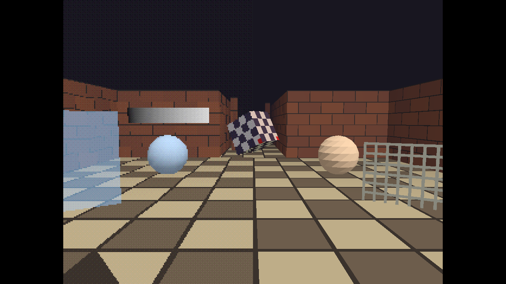

# Copperframe Engine

Copperframe Engine is a Rust game engine for making original 3D games with
PlayStation 1 and PlayStation 2-inspired visuals on modern PCs. It is not an
emulator or a console SDK: games run as normal desktop programs on top of
[wgpu](https://wgpu.rs), and the retro look comes from a renderer whose
every effect is a switch you can turn on, off or tune.

> **Status:** early prototype. All six milestones of the original plan are
> implemented and tested on Linux with a software GPU. Windows 11 is the
> primary target; runtime checks on real Windows hardware are still
> outstanding. See [STATUS.md](https://github.com/JasonAlkain/PSX-Game-Engine/blob/main/docs/STATUS.md)
> for exactly what has and has not been verified.

## What you get

- **A retro renderer** with PS1, PS2 and Clean presets: low internal
  resolution with integer or fit upscaling, vertex snapping, affine texture
  mapping, colour reduction, ordered dithering and fog; filtered and
  mipmapped textures, per-vertex or per-pixel lighting, up to 8 point
  lights and blob shadows. The same content renders in either style
  without being rebuilt.
- **A scene editor** (egui) with a hierarchy, inspector, translate gizmo,
  undo/redo, asset browser, and a Play button that runs your game in its
  own window on a copy of the scene.
- **A command-line tool**, `copperframe`, that creates, validates, inspects
  and edits projects through the same command layer as the editor, so
  scripts and AI agents can build scenes too.
- **Gameplay in Rust:** behaviours you register in a small game crate,
  rapier3d physics (static, kinematic and dynamic bodies, sensors, ray
  casts, a first-person character controller), kira audio (music and effects
  buses, positional sound), named input actions with rebinding, skinned
  glTF characters with animation crossfades.
- **A player app** with title, pause and settings menus, saves, and the
  graphics style switchable between PS1 and PS2 while playing.
- **Headless runs and export:** play a scene with no window, GPU or audio
  from a script with expectations, and export a standalone game folder that
  is checked by running it.

The example project, *The Lever Room*, is a short first-person exploration
game that uses all of this.

## How this wiki is organised

| Section | Read it when |
| --- | --- |
| [Getting started](getting-started/installing.md) | You want to build the engine, play the demo and make a project |
| [Making games](guide/editor.md) | You are building scenes, choosing a look, importing assets or writing behaviours |
| [Reference](reference/cli.md) | You need the exact flags, batch operations, file formats or API calls |
| [Engine development](dev/architecture.md) | You want to change the engine itself |
| [Help](help/troubleshooting.md) | Something does not work, or crashed |

The wiki lives in the repository under `docs/wiki/` and is published from
`main`, so it always describes the code next to it. Deeper design notes stay
in the repository's `docs/` folder:
[ARCHITECTURE.md](https://github.com/JasonAlkain/PSX-Game-Engine/blob/main/docs/ARCHITECTURE.md),
[MIGRATION.md](https://github.com/JasonAlkain/PSX-Game-Engine/blob/main/docs/MIGRATION.md),
[PLATFORMS.md](https://github.com/JasonAlkain/PSX-Game-Engine/blob/main/docs/PLATFORMS.md) and
[STATUS.md](https://github.com/JasonAlkain/PSX-Game-Engine/blob/main/docs/STATUS.md).

## A note on names

The engine was called "PSX Engine" before it became Copperframe. Names that
identify the engine changed (`copperframe_*` crates, the `copperframe`
command), but on-disk data formats kept their `psx` names on purpose: the
`psx_*` format tags, `psx_style.json`, the project's `.psx/` folder and the
built-in behaviour kinds `psx.player`, `psx.camera_zone` and `psx.spin`.
Seeing `psx` in a file is expected, not a leftover.
